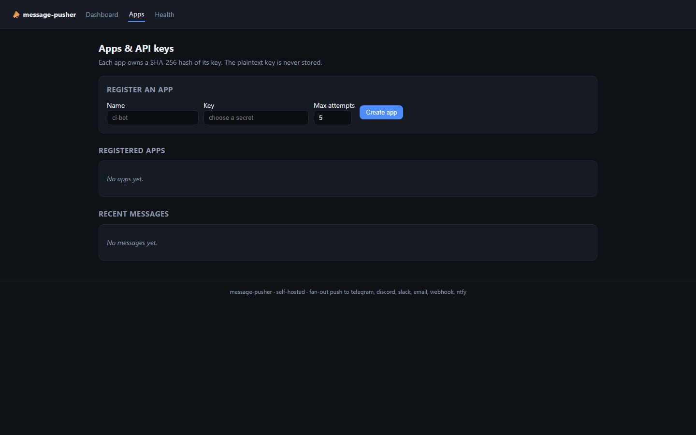
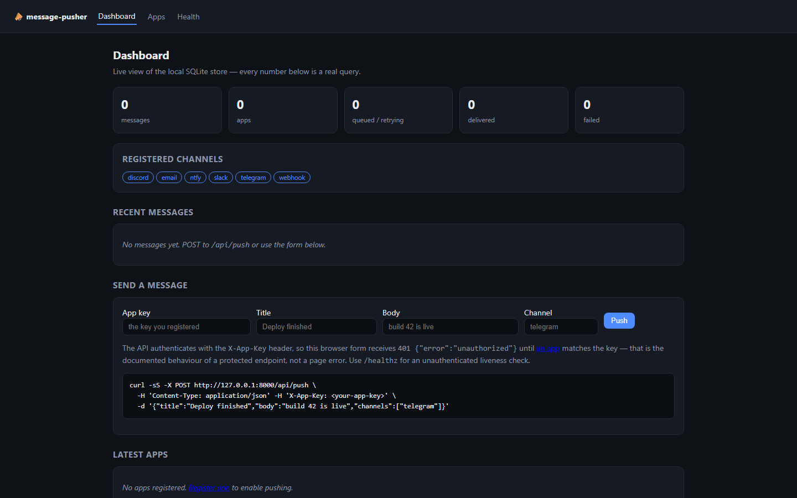
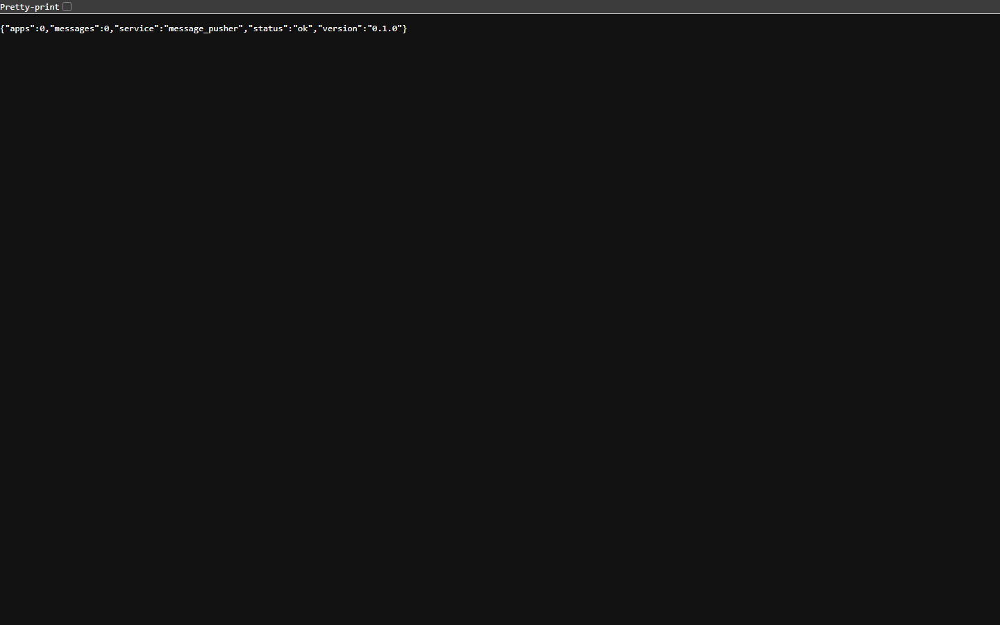
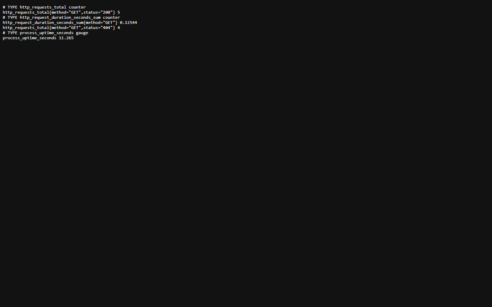
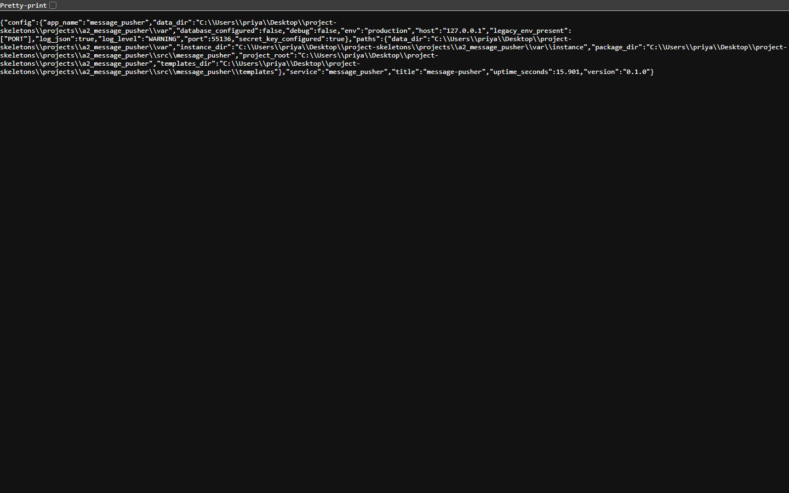

<p align="center">
  
</p>

<h1 align="center">fanoutkit</h1>

<p align="center"><b>One HTTP call, every channel: Telegram, Discord, Slack, ntfy, email, webhook.</b></p>

<p align="center">
  <a href="#quality-gates"></a> <a href="#quality-gates"></a> <a href="#api"></a> <a href="#requirements"></a> <a href="LICENSE"></a>
</p>

fanoutkit accepts a single message from your application and delivers it to every channel you configured for that app — with per-channel retries, a stored delivery record, and a status endpoint you can poll.

---

**Contents** &nbsp;·&nbsp; [Why](#why-this-exists) &nbsp;·&nbsp; [What it does](#what-it-does) &nbsp;·&nbsp; [Quickstart](#quickstart) &nbsp;·&nbsp; [API](#api) &nbsp;·&nbsp; [Screenshots](#screenshots) &nbsp;·&nbsp; [Measured](#measured-not-estimated) &nbsp;·&nbsp; [Architecture](#architecture) &nbsp;·&nbsp; [Quality gates](#quality-gates) &nbsp;·&nbsp; [Deploy](#deploy) &nbsp;·&nbsp; [Limits](#limits-stated-rather-than-hidden)

## Why this exists

Notification code is where applications quietly rot: each new channel adds a client, its own retry rules and its own failure mode, and none of it is observable. fanoutkit puts one endpoint and one delivery table in front of all of them, so a failed Slack post is a row with a status and a retry button, not a log line nobody reads.

## What it does

| Capability | How it works |
| --- | --- |
| **Channel registry** | Telegram, Discord, Slack, ntfy, SMTP email and a generic webhook, each a class that registers itself by name. |
| **Per-channel delivery records** | One row per (message, channel) with status and error text; the message status endpoint aggregates them. |
| **Retry without resending everything** | POST /api/messages/<id>/retry re-runs only the channels that failed. |
| **App-scoped routing** | An app owns its channel configuration, so two services do not share credentials by accident. |
| **HTML + JSON** | An /apps page manages configuration; the API does the same work for automation. |

## Quickstart

```sh
git clone https://github.com/scar8969/fanoutkit.git
cd fanoutkit
python -m venv .venv && . .venv/bin/activate   # Windows: .venv\Scripts\activate
pip install -e ".[dev]"
python wsgi.py                                 # http://127.0.0.1:8000
```

The same work from the CLI:

```sh
python -m message_pusher.cli --help
```

Commands: `push`, `status`, `retry`, `apps`.

A first request:

```sh
curl -s http://127.0.0.1:8000/api/push | head
```

## Requirements

- Python **3.11+** — CI runs 3.11, 3.12 and 3.13.
- Runtime dependencies: `Flask>=3.0`, `Flask-SQLAlchemy>=3.1`, `SQLAlchemy>=2.0`, `PyYAML>=6.0`, `requests>=2.31`.
- No JavaScript build step: every page is server-rendered Jinja.

## API

Every route below is in [`openapi/fanoutkit.yaml`](openapi/fanoutkit.yaml) and is exercised by the live probe recorded in [`docs/EVIDENCE.md`](docs/EVIDENCE.md).

| Method | Path | What it does |
| --- | --- | --- |
| `POST` | `/api/push` | push message |
| `GET` | `/api/status/<id>` | message status |
| `POST` | `/api/messages/<id>/retry` | retry |

## Screenshots

Captured from the running service with headless Chromium at 1440×900, one image per page, committed under [`docs/assets/screens/`](docs/assets/screens/).

<table>
<tr>
<td width="50%"><br><sub><code>/</code> &middot; 55.0 KB</sub></td>
<td width="50%"><br><sub><code>/healthz</code> &middot; 8.9 KB</sub></td>
</tr>
</table>

<table>
<tr>
<td width="50%"><br><sub><code>/livez</code> &middot; 7.3 KB</sub></td>
<td width="50%"><br><sub><code>/metrics</code> &middot; 14.7 KB</sub></td>
</tr>
</table>

<table>
<tr>
<td width="50%"><br><sub><code>/readyz</code> &middot; 7.7 KB</sub></td>
<td width="50%"><br><sub><code>/version</code> &middot; 27.7 KB</sub></td>
</tr>
</table>

## Measured, not estimated

These numbers were produced on this checkout by `pytest --cov` and by booting `wsgi.py` and issuing one real GET per documented path. The commands are in [`docs/EVIDENCE.md`](docs/EVIDENCE.md).

| Signal | Value |
| --- | --- |
| Tests | **189 / 189 passed** (7.8 s, exit 0) |
| Line coverage | **100.0%** — 761 of 761 statements |
| Source | 22 files / 1,558 lines |
| Test code | 12 files / 2,525 lines |
| Documented paths | 3 in the spec, 1 GET |
| Live probe | 9 GET requests to the booted app, **7 answered 200** |
| Median latency | **22.6 ms** (single uncached request, dev server) |
| Slowest / fastest | 82.0 ms `/` / 13.9 ms `/livez` |
| Bytes served | 11.3 KB across 9 responses |
| Screenshots | 7 captured |

## Architecture

```
fanoutkit/
├── src/message_pusher/
│   ├── http.py                         391  HTTP plumbing for message_pusher: correlation ids, a
│   ├── config.py                       174  Environment-driven configuration for message_pusher
│   ├── observability.py                169  Structured logging and request correlation for messa
│   ├── cli.py                          151  message-pusher CLI — queue a push, inspect status, r
│   ├── app.py                          119  Application factory for message_pusher
│   ├── _app.py                         113  
│   ├── errors.py                       108  Typed application errors and their HTTP mapping for 
│   ├── pusher/api.py                    62  
│   ├── models.py                        57  
│   ├── pusher/dispatch.py               57  
│   ├── paths.py                         52  Filesystem layout for message_pusher
│   ├── pusher/retry.py                  38  
├── openapi/fanoutkit.yaml                 the contract of record
├── schema/fanoutkit.sql                   the DDL
├── tests/                       the suite that has to stay green
├── docs/EVIDENCE.md             the recorded live route walk
├── Dockerfile                   multi-stage build
└── wsgi.py                      entry point
```

The package keeps one shape across the service: `config.py` reads the environment once, `observability.py` emits structured JSON logs carrying a request id, `errors.py` turns exceptions into a single JSON envelope, `models.py` holds the tables, and the `pusher/` package holds the routes.

## Quality gates

| Gate | Command | Threshold |
| --- | --- | --- |
| Suite | `pytest -q` | all green |
| Coverage | `pytest --cov` | floor set in `pyproject.toml` from the measured value |
| Lint | `ruff check src tests` | zero findings |
| Format | `ruff format --check src tests` | zero reformats |
| Types | `mypy src` | zero errors |
| Security | `bandit -c pyproject.toml -r src` | reviewed skip list, no unreviewed finding |
| Live routes | boot `wsgi.py`, one GET per documented path | no 5xx, no undocumented guard |

CI runs the first six on Python 3.11, 3.12 and 3.13 for every push to `main`, plus a container build. See [`.github/workflows/ci.yml`](.github/workflows/ci.yml).

## Deploy

```sh
docker build -t fanoutkit .
docker run --rm -p 8000:8000 --env-file .env.example fanoutkit
```

Configuration is environment-only — every variable is documented in [`.env.example`](.env.example), and the service refuses to start with a production secret missing.

## Limits, stated rather than hidden

- Delivery is synchronous per request: the HTTP call returns once every channel has answered or timed out.
- Email requires a reachable SMTP host; without one that channel reports the connection error and the other channels still deliver.

## License

MIT — see [LICENSE](LICENSE).
